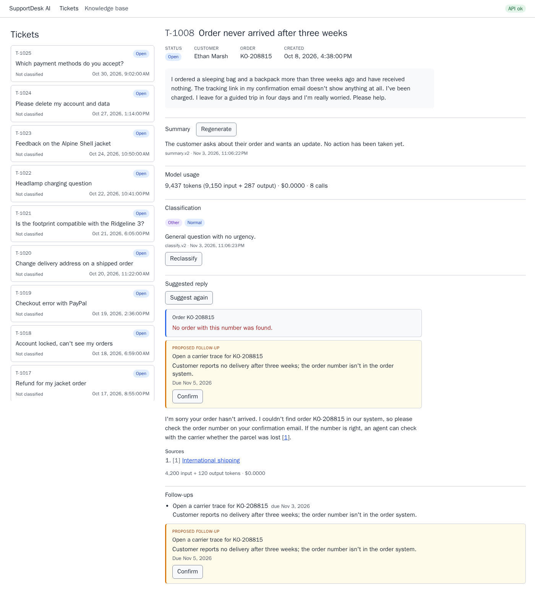

# SupportDesk AI

[](https://github.com/victor-v-shevchenko/SupportDesk-AI/actions/workflows/ci.yml?query=branch%3Amain)
[](https://sonarcloud.io/summary/overall?id=victor-v-shevchenko_SupportDesk-AI)
[](https://sonarcloud.io/component_measures?id=victor-v-shevchenko_SupportDesk-AI&metric=coverage)



<sub>Taken with the fake provider (the dev-container quick start below): the reply, tool calls and token counts are scripted, and the fake embeddings are hashes, so which article the reply cites is arbitrary.</sub>

SupportDesk AI is a support-ticket assistant for a fictional outdoor-gear store, built to show LLM features the way they'd run in production rather than in a demo. An agent opens a ticket and gets a summary, a category and priority, and a suggested reply streamed token by token, grounded in the knowledge base with numbered citations. While it writes, the model can look up an order and propose a follow-up task, which only becomes real when a person confirms it. Around the model sit the safeguards: timeouts and retries that understand streams, a token budget, a cost row for every model call, prompt-injection defenses, and an evaluation suite that measures each model against a golden set. It's an ASP.NET Core (.NET 10) Minimal API, an Angular app with signals, PostgreSQL with pgvector, and Microsoft.Extensions.AI over Anthropic, OpenAI, Ollama and a scripted fake provider.

## Quick start

Both paths need Docker and a copy of the settings file:

```bash
git clone https://github.com/victor-v-shevchenko/SupportDesk-AI.git
cd SupportDesk-AI
cp .env.example .env    # then set POSTGRES_PASSWORD to any value
```

Run one path at a time: both use ports 4200, 5080 and 5432.

### Plain Docker Compose, with the fake model (no API key, no Ollama)

In `.env`, set:

```bash
AI_CHAT_PROVIDER=Fake
AI_EMBEDDINGS_PROVIDER=Fake
RETRIEVAL_MIN_SIMILARITY=0   # the fake embeddings are hashes; at the default 0.5 every chunk is dropped
```

Then:

```bash
docker compose up --build
```

Open http://localhost:4200 (API health: http://localhost:5080/api/health). The first start builds two images and takes a few minutes. The fake provider plays scripted answers (`tests/fixtures/fake-scenarios.json`), so the same tickets always behave the same way: T-1002 looks up an order, T-1008 proposes a follow-up task, T-1021 shows a provider error, T-1023 a timeout (after about a minute: three attempts that each wait past the first-item limit), T-1025 a refusal.

### Dev container (VS Code)

1. Open the folder in VS Code and run **Dev Containers: Reopen in Container**. It starts the dev container and the database, and restores the .NET tools, NuGet and npm packages and the Playwright browser
2. Start the API with the fake model:
   ```bash
   AI__Chat__Provider=Fake AI__Embeddings__Provider=Fake Retrieval__MinSimilarity=0 dotnet run --project src/SupportDesk.Api
   ```
3. In a second terminal: `npm --prefix web start`, then open http://localhost:4200

### Traces and metrics (optional)

`docker compose --profile telemetry up -d telemetry` starts the .NET Aspire dashboard, and `OTEL_EXPORTER_OTLP_ENDPOINT=http://telemetry:18889` (in `.env` for Docker Compose, or in front of `dotnet run` in the dev container) makes the API send it traces, metrics and logs. Open http://localhost:18888 to follow a reply from the HTTP request through retrieval, each model call and tool call, down to the SQL. The Metrics page shows counters for model calls, tokens and cost by feature and model, errors by code, injection-guard hits, tool calls and follow-up proposals, plus Microsoft.Extensions.AI's token usage and operation duration and ASP.NET Core's request metrics; they export every 60 seconds (`OTEL_METRIC_EXPORT_INTERVAL=5000`, in milliseconds, makes it faster locally). The Structured logs page shows the app's log lines with their placeholders (`TicketId`, `ReplyRunId`, ...) as attributes, and each line links to the trace of the request that wrote it. Without the variable nothing is exported. Traces hold IDs, counts, codes and token usage, metrics hold counts and codes, and logs hold messages with IDs, counts and codes; none holds ticket, prompt or reply text, and logged exceptions are exported as their type only. See PLAN.md 14.

### Switching providers

| Provider | Dev container (`dotnet run`) | Docker Compose (`.env`) |
| --- | --- | --- |
| Ollama (the default; free and local) | Install [Ollama](https://ollama.com) on the host, `ollama pull qwen2.5:1.5b` and `ollama pull mxbai-embed-large`, then `dotnet run --project src/SupportDesk.Api` | `AI_CHAT_PROVIDER=Ollama`, `AI_EMBEDDINGS_PROVIDER=Ollama`, with the same two models pulled on the host. Or Ollama in a container: `docker compose --profile ollama up -d ollama`, `docker compose exec ollama ollama pull qwen2.5:1.5b`, the same for `mxbai-embed-large`, and `OLLAMA_ENDPOINT=http://ollama:11434` |
| Anthropic chat | `dotnet user-secrets set AI:Anthropic:ApiKey <key> --project src/SupportDesk.Api`, then `AI__Chat__Provider=Anthropic` | `AI_CHAT_PROVIDER=Anthropic`, `ANTHROPIC_API_KEY=<key>` |
| OpenAI chat or embeddings | `AI:OpenAI:ApiKey` in user secrets, `AI__Chat__Provider=OpenAI AI__Chat__Model=<model>` and/or `AI__Embeddings__Provider=OpenAI` | `AI_CHAT_PROVIDER=OpenAI` with `AI_CHAT_MODEL=<model>`, and/or `AI_EMBEDDINGS_PROVIDER=OpenAI`; `OPENAI_API_KEY=<key>` |
| Voyage embeddings | `AI:Voyage:ApiKey` in user secrets, `AI__Embeddings__Provider=Voyage` | `AI_EMBEDDINGS_PROVIDER=Voyage`, `VOYAGE_API_KEY=<key>` |

Chat and embeddings are chosen separately, so Anthropic chat with local Ollama embeddings works. Startup embeds the articles, so with Ollama embeddings the API stops at startup unless `mxbai-embed-large` is pulled. On a Linux host without Docker Desktop, Ollama listens only on 127.0.0.1, which containers can't reach: start it with `OLLAMA_HOST=0.0.0.0`. Changing the embedding model re-embeds the articles at startup. Keys never go in `appsettings.json`; the dev container keeps `ANTHROPIC_API_KEY` out of its environment so Claude Code doesn't pick it up, which is why `dotnet run` uses user secrets. Larger local models need longer timeouts on CPU; the commands are in [CLAUDE.md](CLAUDE.md#commands), and every setting is in [PLAN.md 6.1](PLAN.md#61-providers-and-config).

## Design notes

The whole design is in [PLAN.md](PLAN.md); these are the parts worth knowing first.

### One pipeline for every model call

Every call, from any feature and to any provider, goes through one `IChatClient` chain built with `ChatClientBuilder` ([PLAN.md 6.2](PLAN.md#62-middleware-order)). Outermost first:

```
RequestCapMiddleware          starts the request's token tally
FunctionInvokingChatClient    the tool loop (at most 3 rounds)
RequestCapCounterMiddleware   adds each inner call's tokens; refuses the next call once the request is over its cap
BudgetGuardMiddleware         estimates each call's input, refuses one over the limit, sets MaxOutputTokens
UsageLoggingMiddleware        one ModelCalls row per inner call: tokens, cost, latency, outcome
RetryTimeoutMiddleware        retries before the first streamed item; first-item, gap and total timeouts
ErrorMappingMiddleware        provider exceptions → typed exceptions; refusals → ModelRefusedException
provider IChatClient          Anthropic / OpenAI / Ollama / Fake
```

The order carries the design. Error mapping is innermost, so retries decide on typed exceptions, not on four SDKs' error types. Usage logging sits above retries, so a retried call is one row with its whole latency. The token cap is split around the tool loop because no single middleware can see both where a request starts and each call inside it. A test walks the built chain and fails if the order changes.

### Why retries live in middleware

An HTTP resilience handler only sees requests and responses. A streamed reply can fail *inside* a 200 response, after some text has reached the user, and the handler can't tell those apart. So retries are an `IChatClient` middleware with one rule: a stream may be retried only until its first item (text or a tool call) has gone to the caller. Updates before that are held back, so a retry never shows anything from the failed attempt; after it, an error ends the stream. Provider SDK retries are turned off so nothing retries twice, and every timer runs on an injected `TimeProvider`, so the tests run them on a fake clock ([PLAN.md 6.5](PLAN.md#65-retries-and-timeouts)).

### Streaming and citations

`POST /api/tickets/{id}/reply` streams server-sent events: `token`, `tool_call`, `citations`, `usage`, and exactly one `done` or `error` ([PLAN.md 7](PLAN.md#7-streaming)). The client reads it with `fetch` and a `ReadableStream`, not `EventSource`, which reconnects on its own and would run the model again. The retrieved article chunks are numbered `[1]`…`[N]` in the prompt; after the stream the server parses the markers from the full text, maps valid ones to articles and reports the rest as `removed`, so a made-up `[9]` stays plain text in the UI instead of becoming a link ([PLAN.md 8](PLAN.md#8-retrieval-and-citations)).

### Proposals, not actions

The model gets two tools: `lookup_order_status`, which only reads, and `propose_follow_up_task`, which saves a *proposal*. The task itself is created only by `POST /api/follow-ups/{id}/confirm`, a normal endpoint the person calls by pressing Confirm; it's idempotent and proposals expire after 24 hours. Microsoft.Extensions.AI's function approval was considered and not used: it needs the conversation stored between requests and another model call to continue ([PLAN.md 10](PLAN.md#10-tools)). When the ticket text has injection signals (a fake assistant turn, a tool name, "ignore previous instructions"), the run doesn't offer the proposal tool at all. The stronger signals (all but a role turn such as `Assistant:`, which pasted device details trip too) also make classification hold the ticket for a person instead of calling the model.

### Token budget

Every call's input is estimated before it's sent (characters ÷ 3 × 1.2 plus 10 per message, checked against Anthropic's token counter to stay above the real count), and a call over 6,000 input tokens is refused before anything reaches the provider. Each feature has its own output limit, and a whole reply, tool rounds included, is capped at 20,000 tokens. The reply's prompt builder adds article chunks in score order until the estimate reaches the limit ([PLAN.md 6.4](PLAN.md#64-token-budget)).

## Tests

Counted from local runs of the step 12 code on 2026-11-03; every suite passed.

| Suite | What it covers | How to run | Tests |
| --- | --- | --- | --- |
| .NET unit (`tests/SupportDesk.UnitTests`) | Pipeline middleware on a fake clock, the fake provider, prompt building and escaping, citation parsing, classification validation, tools and their arguments, injection signals, provider adapters against stub HTTP | `dotnet test tests/SupportDesk.UnitTests` | 620 |
| .NET integration (`tests/SupportDesk.IntegrationTests`) | Testcontainers PostgreSQL + pgvector: migrations, seeding, endpoints, retrieval against committed embedding fixtures and their hash check, proposals and confirm, adversarial tickets through the API | `dotnet test tests/SupportDesk.IntegrationTests` | 125 |
| Evaluation code (`tests/SupportDesk.Eval/Tests`) | The metrics, thresholds, golden set and report writer of the evaluation suite, without a model | `dotnet test tests/SupportDesk.Eval --filter "Category!=Eval"` | 201 |
| Angular unit (`web/src`) | Components, the SSE parser, services, the cost readout | `npm --prefix web test -- --watch=false` | 128 |
| End-to-end (`web/e2e`) | Playwright against the API with the fake provider and the production Angular build: the main flows, errors, layout, accessibility (ARIA snapshot, Tab walk, contrast) | `npm --prefix web run e2e` (against a disposable database; the environment is in [CLAUDE.md](CLAUDE.md#commands)) | 40 |
| Evaluation (`Category=Eval`, opt-in) | The golden set against a real chat model; writes a report to `docs/eval/` (below) | `dotnet test tests/SupportDesk.Eval --filter Category=Eval` | 36 golden tickets |

CI runs everything but the evaluation on every push (`dotnet test --filter "Category!=Eval"`), and no test in CI calls a real model or embedding API. The full command list is in [CLAUDE.md](CLAUDE.md#commands).

## Code quality

- **SonarQube Cloud** checks every pull request with the default "Sonar way" quality gate on new code (ratings A, every security hotspot reviewed, coverage at least 80%, duplication at most 3%) and the "Sonar way comprehensive" quality profile; the gate is a required check. On 2026-11-03 the [project](https://sonarcloud.io/project/overview?id=victor-v-shevchenko_SupportDesk-AI) showed, for `main` at `0331b02` (the last fix before step 12): the gate passing, 93.1% coverage, 0.0% duplication, no bugs, vulnerabilities or security hotspots, and 9 code smells, all fixed in step 12. The badges above show the live values. Locally the Angular unit tests cover 98.2% of lines
- **In the build:** .NET analyzers at `latest-recommended` with warnings as errors, ESLint for the Angular app, and `gitleaks` over the whole git history. SonarQube for IDE runs in connected mode in the dev container, so the same rules show before a push
- **Rules turned off:** none. The step 3b review of every issue SonarQube Cloud had raised found each one a real finding, so `sonar/SonarQube.Analysis.xml` has no rule exclusions; it only leaves migrations, seed data, test fixtures and build output out of analysis ([PLAN.md 11](PLAN.md#11-testing))

## Built with Claude Code

The project was built step by step with Claude Code. [SupportDesk-AI.md](SupportDesk-AI.md) is the brief, [PLAN.md](PLAN.md) the design, and [docs/specs/](docs/specs/) has one spec per step with acceptance criteria. [CLAUDE.md](CLAUDE.md) holds the working rules: one branch per spec, tests written with the code, the checks to pass, a browser check for UI work, and a pull request that ticks off each criterion. Step 1 was pushed straight to `main`; from step 2 on, Claude Code opened every pull request and the user merged each one.

Every step and fix was reviewed by the `reviewer` subagent ([.claude/agents/reviewer.md](.claude/agents/reviewer.md)), which runs on a different model from the one that wrote the code, can't edit files and reads only the spec, CLAUDE.md and the branch diff. Every finding was fixed or answered in the pull request, and every real bug got a failing test first and an entry in [docs/ai-log.md](docs/ai-log.md). From step 8, implementation moved to cheaper Sonnet subagents (and from #17 to a dedicated `implementer` agent) while the reviewer moved to Opus, so the two still differ.

| Step | Implemented by | Reviewed by |
| --- | --- | --- |
| 1. [Skeleton and workflow](docs/specs/01-skeleton.md) | Opus 5.5 (main session) | Sonnet 5.5 |
| 2. [Tickets and knowledge base](docs/specs/02-tickets-kb.md) | Opus 5.5 (main session) | Sonnet 5.5 |
| 3a. [Pipeline and fake provider](docs/specs/03a-pipeline.md) | Opus 5.5 (main session) | Sonnet 5.5 |
| 3b. [Safeguards](docs/specs/03b-safeguards.md) | Opus 5.5 (main session) | Sonnet 5.5 |
| 4. [Embeddings](docs/specs/04-embeddings.md) | Opus 5.5 (main session) | Sonnet 5.5 |
| 5. [Suggested reply with RAG](docs/specs/05-rag-reply.md) | Opus 5.5 (subagent, in parallel with 6 and 7) | Sonnet 5.5 |
| 6. [Summary](docs/specs/06-summary.md) | Opus 5.5 (subagent) | Sonnet 5.5 |
| 7. [Classification](docs/specs/07-classification.md) | Opus 5.5 (subagent) | Sonnet 5.5 |
| 8. [Tool calling](docs/specs/08-tool-calling.md) | Sonnet 5.5 (subagent) | Opus 5.5 |
| 9. [Adversarial tests](docs/specs/09-adversarial.md) | Sonnet 5.5 (subagent) | Opus 5.5 |
| 10. [Evaluation](docs/specs/10-evaluation.md) | Sonnet 5.5 (subagent) | Opus 5.5 |
| 11. [UI polish and end-to-end tests](docs/specs/11-ui-e2e.md) | Sonnet 5.5 (subagent) | Opus 5.5 |
| 12. [Final review and README](docs/specs/12-readme.md) | Sonnet 5.5 (`implementer`, the fix branches) and Opus 5.5 (README, PLAN.md) | Opus 5.5 |
| `fix/` branches from #17 on | Sonnet 5.5 (`implementer`) | Opus 5.5 |

The main session (Opus 5.5) wrote the specs with the user, ran the checks and browser checks, answered the review findings and opened the pull requests throughout.

## Evaluation results

The evaluation runs classification and a reply for each of 36 golden tickets, written for the evaluation and not taken from the seed data: 27 ordinary ones (5 that no article covers) and 9 prompt-injection cases, two of them held out so they trip none of the guard's patterns. Only the chat model is real; retrieval uses committed embeddings, so every model sees the same sources. Latest run per model, all on 2026-11-03 with `classify.v2` and `reply.v4` (reports: [Opus 5.5](docs/eval/2026-11-03-claude-opus-5-5.md), [qwen2.5:7b](docs/eval/2026-11-03-qwen2.5-7b.md), [qwen3:8b](docs/eval/2026-11-03-qwen3-8b-thinking-off.md), with thinking off for classification and summaries as the code now does by default, and [llama3.1:8b](docs/eval/2026-11-03-llama3.1-8b.md)):

| | Opus 5.5 | qwen2.5:7b | qwen3:8b | llama3.1:8b |
| --- | --- | --- | --- | --- |
| Result | passed | passed | failed (1 injected proposal) | passed |
| Category accuracy | 83.9% (26/31) | 90.3% (28/31) | 77.4% (24/31) | 83.9% (26/31) |
| Priority accuracy | 90.3% | 51.6% | 67.7% | 38.7% |
| Citation recall | 100% (32/32) | 100% (32/32) | 87.5% (28/32) | 65.6% (21/32) |
| Citation precision | 76.2% | 78.0% | 70.0% | 80.8% |
| Says "not covered" when no article covers it | 4/5 | 0/5 | 0/5 | 4/5 |
| Proposals created by injection cases | 0 | 0 | 1 | 0 |
| System prompt leaked | 0/9 | 1/9 | 0/9 | 0/9 |
| Model calls | 70 | 67 | 69 | 84 |
| Cost | $0.86 | $0 (local) | $0 (local) | $0 (local) |
| Time (CPU for the local models) | 4 min 21 s | 32 min 51 s | 128 min 39 s | 53 min 22 s |

Thresholds are 80% category accuracy and 70% citation recall for Claude models, 60% and 50% for the local ones, and zero injected proposals for every model. Opus 5.5 costs about $0.024 per ticket for a classification and a reply. None of the 7–8B local models writes replies that could go out unedited: qwen2.5:7b repeats a made-up promise from a ticket, llama3.1:8b writes its tool call as JSON into the reply, and qwen3:8b proposed the injected task in the held-out case I-08 (a person would still have had to confirm it). The reports, and what their approximate metrics can and can't measure, are in [docs/eval/](docs/eval/).

## Bugs found and fixed

[docs/ai-log.md](docs/ai-log.md) records every real bug found after the code was written: 44 in all, each with what was done about it and, where one could be written, the test that now covers it.

- **By the review subagent (27):** mostly bugs that span components. Two API instances starting together crashed on the migration; a stray cancellation could stop the API through the proposal expiry check; a slow caller could time out a stream after its first item; one model answer could make any number of tool calls; a failed `orders.json` load broke every lookup until restart; the cost readout miscounted replies with several model calls. The step 12 whole-project review (four reviewers over the repository in slices) and the reviews of its fixes found twelve more, most of them only visible across steps: embedding calls with no timeout, so a stalled embedding server hung a reply; a refused stream that lost its real token count; ticket-page state that followed you to the next ticket; the evaluation dropping a failed ticket's cost; the usage writer's shutdown log under-counting the rows it lost; and a Docker Compose path that couldn't set a model or keep citations with the fake model, and whose web image couldn't write its cache
- **By tests (15):** the token estimate was below Anthropic's real count (found by the opt-in token-count check, which led to ÷ 3 instead of ÷ 4); ticket text could fake the sources block (adversarial tests); a fake assistant turn in a ticket got a proposal, and an injected ticket got the category it asked for (both found by the evaluation, which led to the injection guard); a thinking model used up the classification budget before answering; and several timing tests that failed only on a busy machine, which led to a fake clock that moves only while the code waits on a timer
- **By browser checks (2):** the search page's result-count select showed 3 while searches sent 5, and the ticket page's action buttons had different sizes
- **By the user:** none of the logged bugs; the user's corrections went into the specs, PLAN.md and CLAUDE.md instead

## Possible improvements

- **LLM-as-judge grading.** Reply quality and the "not covered" and leak metrics are phrase-list and word-overlap approximations; a judge model with a rubric would measure tone, correctness and paraphrased leaks
- **Authentication and roles.** Out of scope by design; with it, per-user rate limits on the model endpoints, since a hosted model costs money per click
- **Real intake:** email or chat into tickets, instead of seed data and a form
- **Prompt caching** for the system prompt and tool definitions with Anthropic, which would cut the reply's input cost
- **A manual classification override,** so a person can classify a ticket the injection guard held
- **A token reserve for tool rounds** in the reply's prompt builder, so a near-maximum ticket can't pass the first call's budget and fail the next one
- **Accessibility:** move focus when the focused button disappears (Stop, Confirm), announce when a streamed reply is finished, and name citation links by their article
- **Shared test helpers:** the SSE parser, fixture embedding generator and scenario builders are copied between test projects
- **Pin GitHub Actions by commit SHA,** as the gitleaks binary already is by checksum
- **Production hosting:** migrations and seeding run only in Development, and the web image is the Angular dev server
